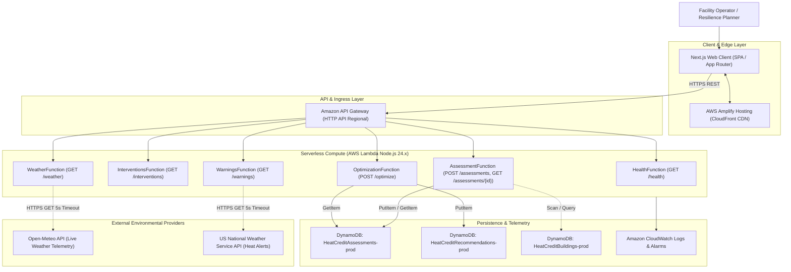
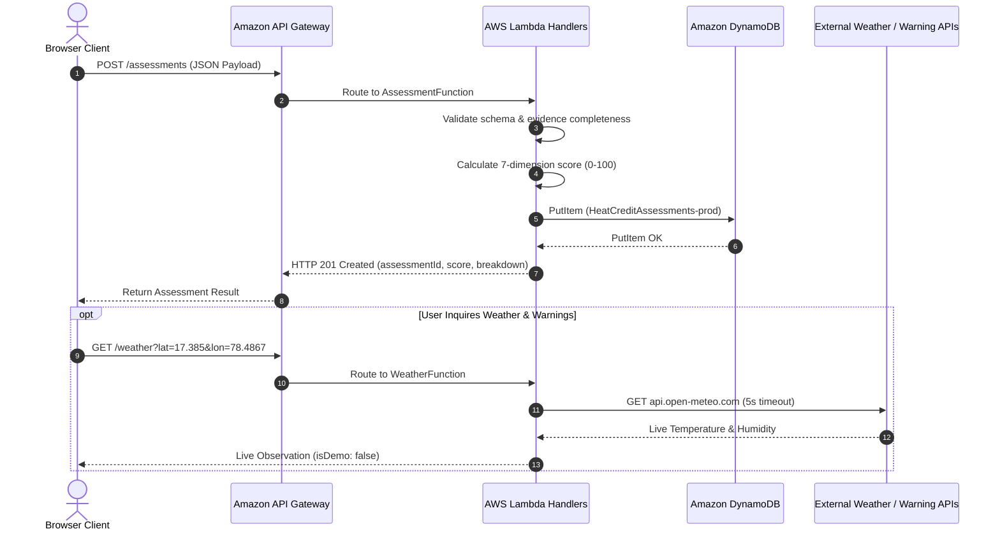
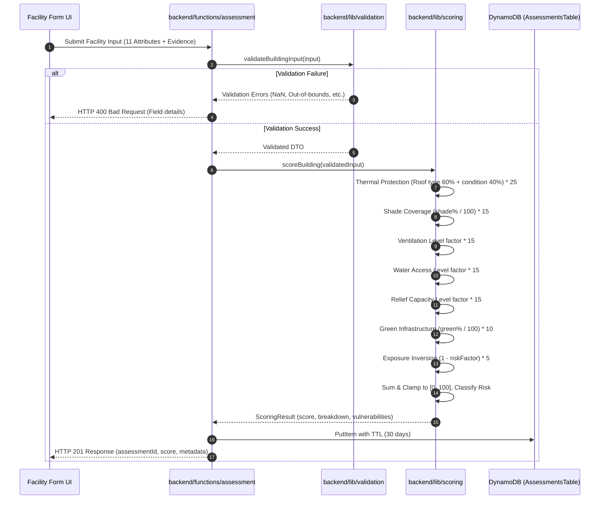
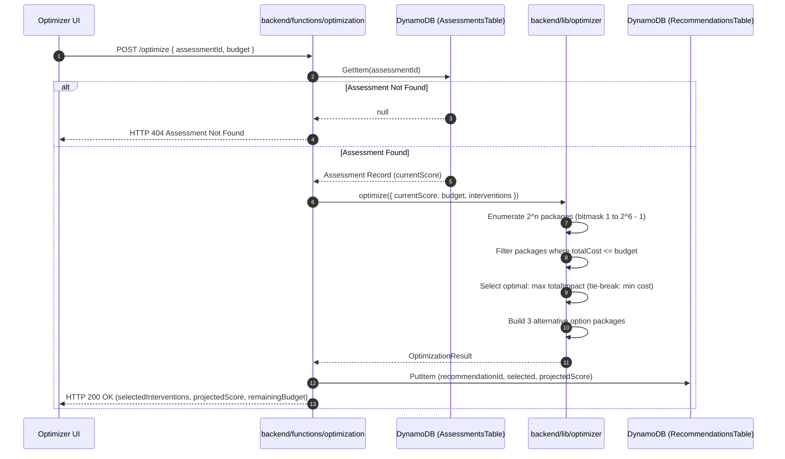
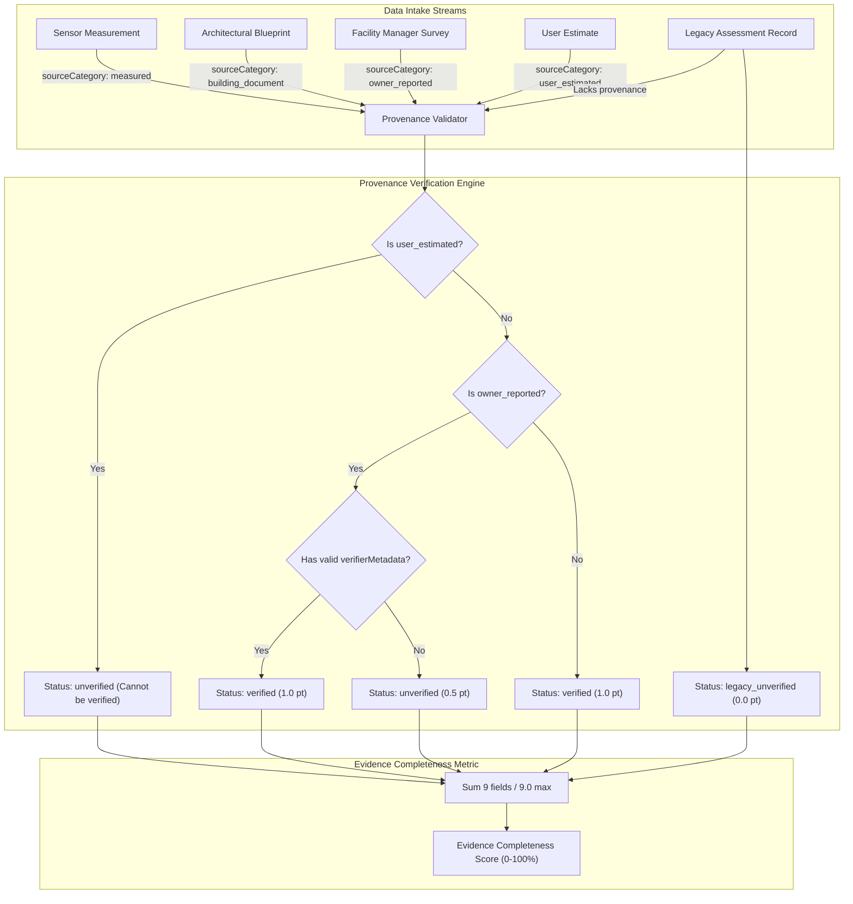
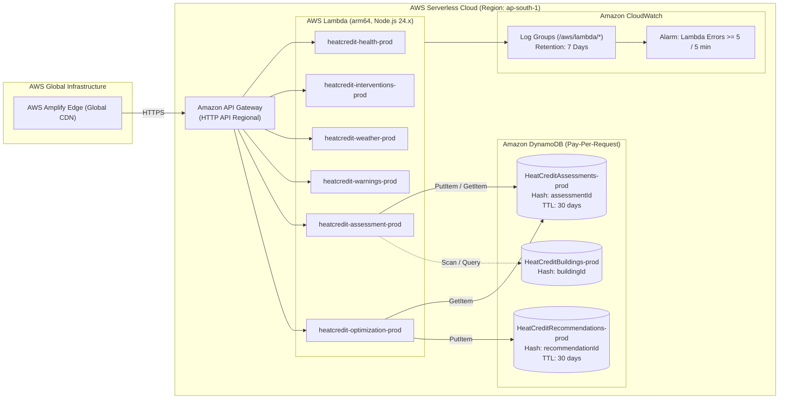

# HeatCredit — System Architecture & Infrastructure

> **Product:** HeatCredit — Heat Resilience Decision Engine
> **Repository:** [GitHub: RishvinReddy/heatcredit-environmental-hacks-2026](https://github.com/RishvinReddy/heatcredit-environmental-hacks-2026)
> **Cloud Provider:** Amazon Web Services (AWS)
> **Region:** `ap-south-1` (Asia Pacific - Mumbai)
> **IaC Framework:** AWS Serverless Application Model (SAM) `template.yaml`

---

## 1. System Overview & Context

HeatCredit is designed as a cloud-native, serverless decision-support platform. The architecture separates presentation logic from deterministic computational kernels and persistence layers.

### Diagram 1: System Context Diagram

---

## 2. Component Responsibilities

### 2.1 Frontend (`apps/web`)
- **Technology:** Next.js 16.4.0 (Turbopack, App Router), React 19, TypeScript, Tailwind CSS, shadcn/ui primitives, Framer Motion, Recharts.
- **Hosting:** AWS Amplify Hosting with continuous integration from GitHub `main`.
- **Primary Routes:**
  - `/` — Editorial Landing Page & Product Introduction.
  - `/overview` — Interactive Facility Resilience Hub & Portfolio Browser.
  - `/assessment` — 11-Factor Facility Intake Form with Evidence Metadata.
  - `/intelligence` — Environmental Risk Analytics & Vulnerability Matrix.
  - `/interventions` — 6-Item Adaptation Catalogue with Rupee Cost Modeling.
  - `/optimizer` & `/optimizer/[id]` — Capital Allocation Lab (0/1 Knapsack Engine).
  - `/scenarios` — Side-by-side Strategy Comparison Studio.
  - `/report` & `/report/[id]` — Printable Executive Decision Sheets.
  - `/methodology` — Transparent Breakdown of 7 Dimensions and Weights.
  - `/architecture` — Interactive System Topology & Infrastructure Canvas.

### 2.2 API & Ingress (`template.yaml`)
- **Technology:** Amazon API Gateway (HTTP API, OpenApiVersion 3.0.1).
- **Endpoint Configuration:** `REGIONAL` (`ap-south-1`).
- **Throttling & Rate Limiting:** Burst limit: 50 req, Rate limit: 100 req/sec.
- **CORS:** Configured for all standard origins with explicit preflight handling (`OPTIONS` handlers on all routes).

### 2.3 Serverless Compute (AWS Lambda)
- **Runtime:** `nodejs24.x` on `arm64` architecture (AWS Graviton) for superior price-performance and reduced execution carbon footprint.
- **Build Method:** `esbuild` target `es2022`, bundled into lightweight, zero-dependency deployment packages.
- **Timeout & Memory:** 15s timeout (10s for external weather/warnings), 256MB memory.

| Lambda Function | Handler Path | Route | DynamoDB Policies |
|---|---|---|---|
| `HealthFunction` | `backend/functions/health/index.ts` | `GET /health` | Basic execution only |
| `InterventionsFunction` | `backend/functions/interventions/index.ts` | `GET /interventions` | Basic execution only |
| `WeatherFunction` | `backend/functions/weather/index.ts` | `GET /weather` | Basic execution only |
| `WarningsFunction` | `backend/functions/warnings/index.ts` | `GET /warnings` | Basic execution only |
| `AssessmentFunction` | `backend/functions/assessment/index.ts` | `POST /assessments` `GET /assessments/{id}` | `DynamoDBCrudPolicy` on `AssessmentsTable` |
| `OptimizationFunction` | `backend/functions/optimization/index.ts` | `POST /optimize` | `DynamoDBReadPolicy` on `AssessmentsTable` `DynamoDBCrudPolicy` on `RecommendationsTable` |

---

## 3. Request & Sequence Flows

### Diagram 2: Frontend-to-Backend Request Flow

### Diagram 3: Assessment and Scoring Sequence

### Diagram 4: Budget Optimization Sequence

### Diagram 5: Data Provenance Flow

---

## 4. AWS Deployment Topology

### Diagram 6: AWS Deployment Topology

---

## 5. Security Boundaries & Trust Zones

1. **Client / Browser Boundary:**
   - Unauthenticated public evaluation portal. All client inputs are considered untrusted and subject to strict server-side JSON schema validation.
2. **API Ingress Boundary:**
   - Protected by API Gateway throttling limits (100 req/sec rate limit, 50 burst).
   - Strict CORS configuration preventing malicious cross-site scripting.
3. **Compute Execution Boundary:**
   - Least-privilege IAM roles: each Lambda function possesses only the minimal necessary DynamoDB permissions (`DynamoDBReadPolicy` or `DynamoDBCrudPolicy`).
   - Node.js 24.x runtime isolation with no local disk persistence beyond `/tmp`.
4. **Data Persistence Boundary:**
   - DynamoDB tables configured with encryption at rest using AWS managed keys (KMS).
   - TTL (Time-To-Live) enabled on ephemeral assessment records (30 days) to prevent unbounded data retention and unnecessary storage charges.

---

## 6. Operational Resilience & Fallback Policies

- **External Provider Outages:** If Open-Meteo or NWS APIs timeout (>5s) or return HTTP 5xx errors, the backend gracefully catches the exception, logs to CloudWatch, and returns an explicit `isDemo: true` fallback payload or `status: "unavailable"` without crashing the client assessment.
- **Cost Guardrails:** CloudWatch log groups are strictly enforced with a **7-day retention policy** to prevent unexpected storage creep. Lambda error alarms alert on unexpected invocation failures.
